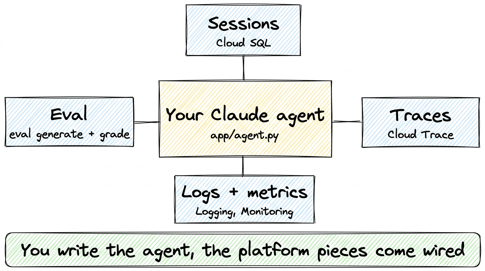
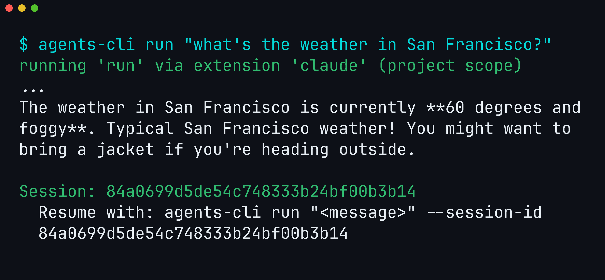
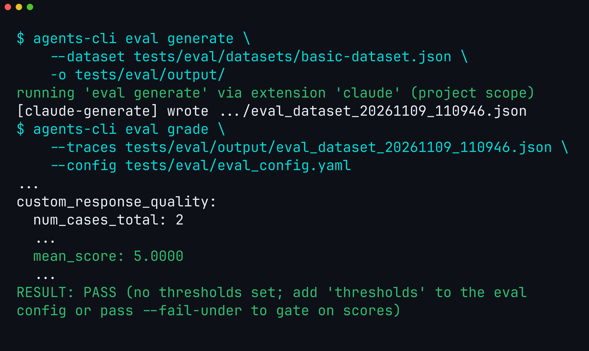
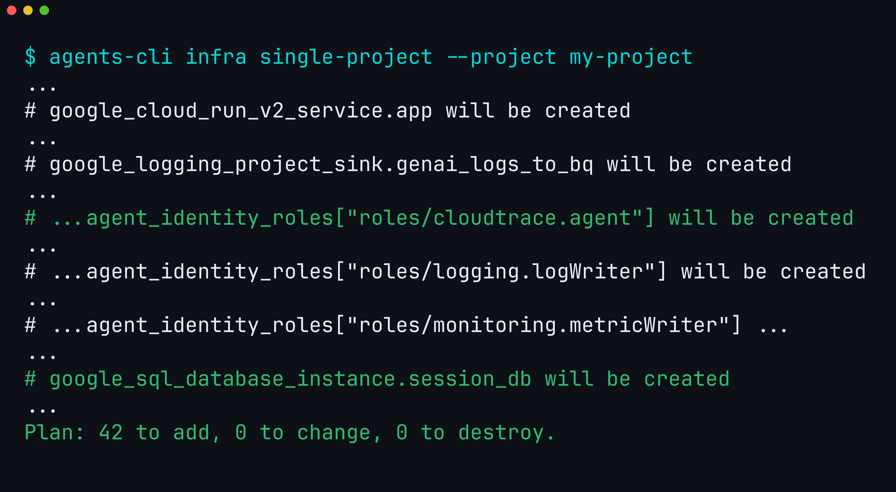
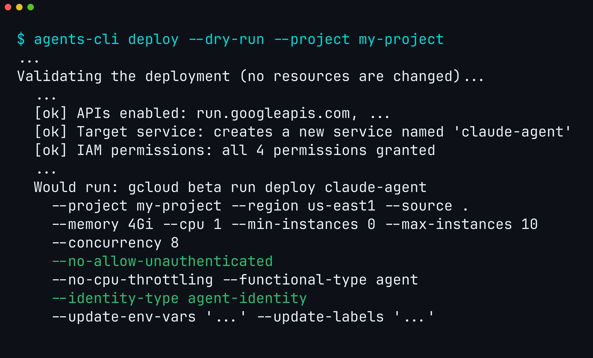

A Claude Agent SDK agent is a few lines of Python. Running it for real users takes more than the agent: somewhere to store each conversation so it isn't lost when the server restarts, traces that show what the agent did at each step when something goes wrong, evals (tests for agent answers) to run before each change, and a secure deploy. That's usually the part teams build by hand.

[Agents CLI](https://github.com/google/agents-cli) already handles these for agents built on the Agent Development Kit (ADK). Since v1.12.0, a first-party extension does the same for Claude Agent SDK agents: you keep writing a `ClaudeAgentOptions`, and you get the same create, run, eval, and deploy commands as an ADK agent. We took one agent from install to a validated deploy on v1.13.0.



Figure 1. You write `app/agent.py`, and the template wires in sessions, traces, logs, metrics, and eval.

## Step 1: Install and create

One command installs Agents CLI and its skills for your coding agent:

```bash
uvx google-agents-cli setup
```

Then create a project from the Claude template, with Cloud Run as the target and Cloud SQL for sessions, and send it a prompt. `run` calls Claude in process through the SDK:

```bash
agents-cli create claude-agent --agent google/agents-cli/extensions/claude/template@v1.13.0 -d cloud_run --session-type cloud_sql -y
cd claude-agent && agents-cli install
agents-cli run "what's the weather in San Francisco?"
```



Figure 2. The Claude extension serves `run`, and the reply ends with a session ID you can resume.

The project's `app/agent.py` is plain Claude Agent SDK code: a `@tool` for the weather, an in-process Model Context Protocol (MCP) server that exposes the tool to Claude, and options that switch off Claude Code's built-in tools (such as running shell commands) so the agent can only call what you allow.

```python
root_agent = ClaudeAgentOptions(
    model="claude-haiku-4-5",
    system_prompt="You are Skye, a helpful assistant. Use get_weather for weather questions.",
    mcp_servers={"weather": weather_server},
    tools=[],
    allowed_tools=["mcp__weather__get_weather"],
    max_turns=10,
)
```

The model has to be enabled in Model Garden, the Google Cloud page where you turn on models for your project. `create` writes the project to `.env` as `GOOGLE_CLOUD_PROJECT`, but `ANTHROPIC_VERTEX_PROJECT_ID` wins if your shell sets it.

## Step 2: Evaluate it like any other agent

An eval has two steps. `eval generate` runs the agent on a set of test prompts and saves its answers, and `eval grade` has a model score those answers. The extension replaces only the first step and saves the answers in the same format ADK agents use, so `eval grade` works unchanged:

```bash
agents-cli eval generate --dataset tests/eval/datasets/basic-dataset.json -o tests/eval/output/
agents-cli eval grade --traces tests/eval/output/<dataset>.json --config tests/eval/eval_config.yaml
```

Here `<dataset>` is the name of the file `eval generate` prints.



Figure 3. `greeting` and `weather_lookup` both scored 5 out of 5.

The template leaves `thresholds:` commented out in `tests/eval/eval_config.yaml`, since only you know your bar. Once you set it, `eval grade` and `eval run` exit 1 when a score falls below it ([v1.13.0](https://github.com/google/agents-cli/blob/main/RELEASE_NOTES.md)), so the same command can gate CI.

## Step 3: See what production adds

`agents-cli infra single-project` uses Terraform, a tool that describes cloud resources as code, to plan everything the agent needs in your project: the Cloud Run service, the database for sessions, and the logging and tracing setup. Without `--apply`, it only prints the plan:

```bash
agents-cli infra single-project --project my-project
```



Figure 4. One plan, 42 resources. We kept the lines for sessions, traces, logs, and metrics.

Apply it once before the first deploy. That creates the Cloud SQL instance, connects the Cloud Run service to it, and gives the agent's identity the Cloud Trace role. We didn't apply it for this post:

```bash
# Not run for this post: creates the resources in the plan above.
agents-cli infra single-project --apply --project my-project
```

Think of the template as a chassis: you bring the engine, and the wiring is already there.

- **Sessions:** with `--session-type cloud_sql` and the infra applied, transcripts go to Cloud SQL, so a conversation can resume on another instance or after a restart. Without the database, they stay on the instance.
- **Traces:** once the infra grants the Cloud Trace permission, every turn and every tool call is recorded as a span (one timed step), and you can open the whole turn as one trace in Cloud Trace.
- **Logs and metrics:** logs go to Cloud Logging tagged with the turn's trace, and turn duration and token usage go to Cloud Monitoring. BigQuery Agent Analytics is optional.

## Step 4: Deploy

`agents-cli deploy` builds your code and deploys it to Cloud Run with `gcloud beta run deploy --source .`. With `--dry-run`, it first checks that your project has the right APIs turned on and that you have the permissions to deploy, without changing anything:

```bash
agents-cli deploy --dry-run --project my-project
```



Figure 5. The dry run validates the project and prints the exact deploy command.

`--no-allow-unauthenticated` keeps the service private, so only callers with access can reach it. `--identity-type agent-identity` gives the agent its own identity in Google Cloud, with only the permissions `deploy` grants it, so it doesn't borrow your account or a shared one. That is the default for new projects since v1.13.0.

Once deployed, the agent speaks the Agent2Agent (A2A) protocol, a standard way for agents and apps to call each other, and you can reach it from your terminal:

```bash
agents-cli run --url https://<service-url> --mode a2a --app-name app "hello"
```

## What to take away

Of the commands we ran, the extension handled only `run` and `eval generate`. `eval grade`, `infra`, and `deploy` ran exactly as they do for an ADK agent. Apply the infra before the first deploy, because that step creates the session database.

To bring an existing agent over, run `scaffold enhance`. It writes the template into your project and moves the files it replaces to `.agents-cli-original/`. Then move your `ClaudeAgentOptions` into `app/agent.py`:

```bash
agents-cli scaffold enhance google/agents-cli/extensions/claude/template@v1.13.0 -d cloud_run
```

To start fresh, install Agents CLI and follow Step 1:

```bash
uvx google-agents-cli setup
```

The [extension guide](https://google.github.io/agents-cli/guide/extensions/first-party/) covers migration step by step, and Agents CLI is on [GitHub](https://github.com/google/agents-cli).
