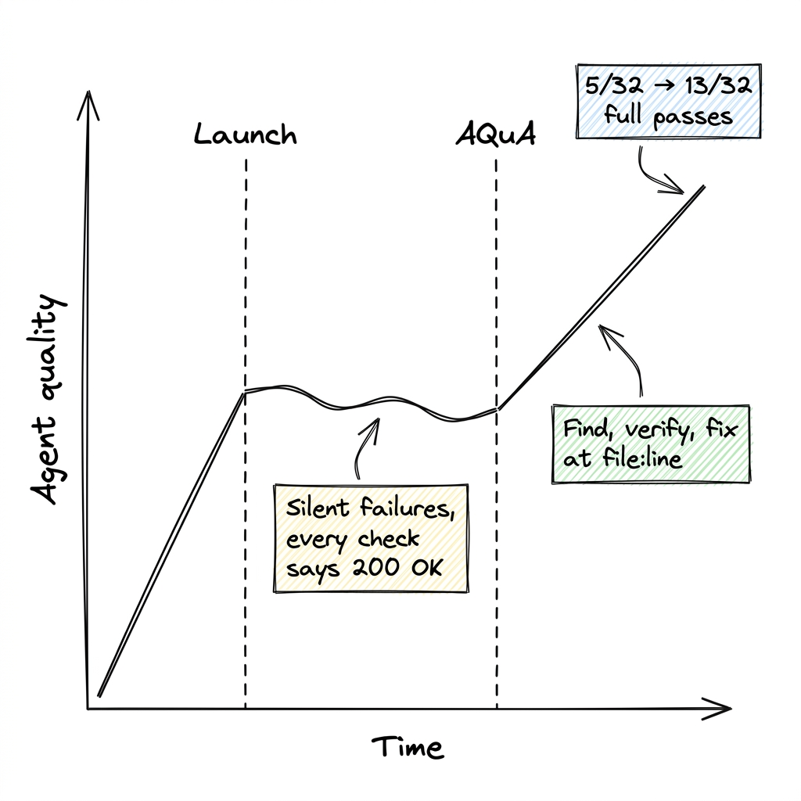
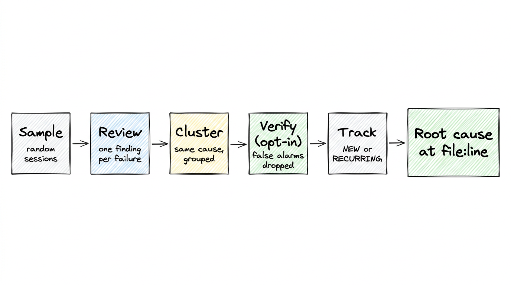
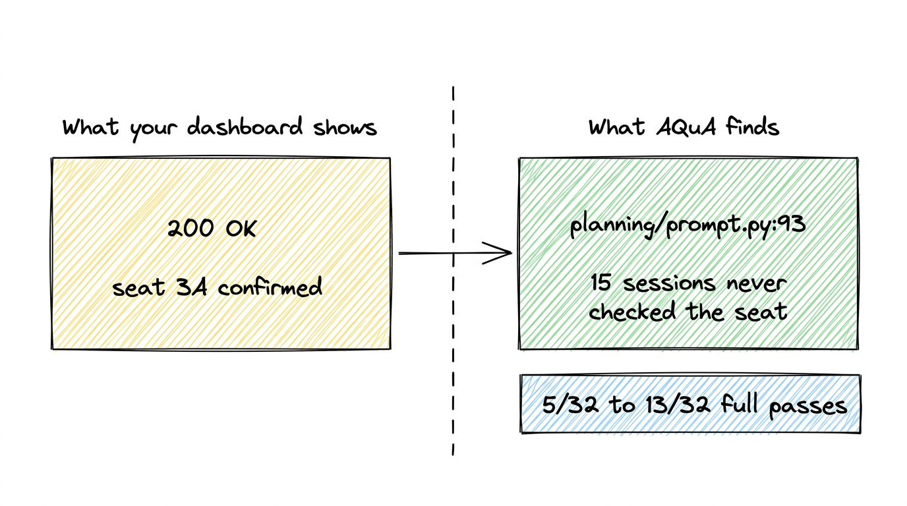
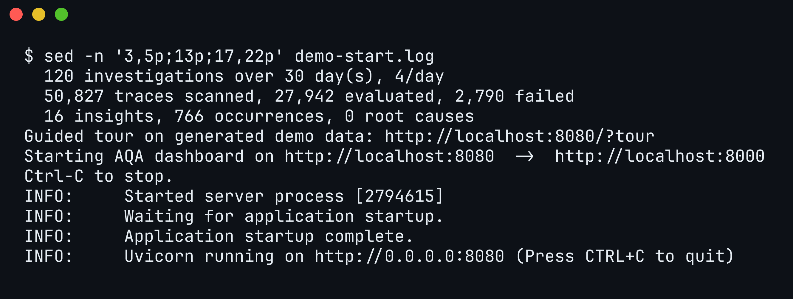
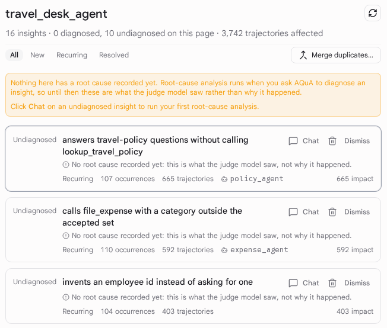

Your agent returns HTTP 200 and stays inside its latency budget, and no tool call raises an error. Yet it records seat 3A as confirmed without ever asking the seat-selection sub-agent whether 3A is free. Nothing in your dashboards turns red, because the only evidence of the mistake sits inside the conversation.

AQuA (Ambient Quality Agent) is an open-source quality agent. It surfaces that kind of failure across many sessions and, when you ask, traces a failure to the line of code behind it. We built AQuA, and Dima Melnyk and I wrote the full [Developers Blog post](https://developers.googleblog.com/the-outer-loop-insights-first-an-ambient-quality-agent-that-diagnoses-your-production-agent/) about it. This companion walks through the same sweep and shows how to run the dashboard on your laptop with no cloud project.

## Why this is hard

Getting an agent to the first 80%, where it handles the cases you anticipated, takes days with an eval dataset and a run, grade, fix and compare loop. Then you launch and the curve flattens. Usage shifts, and a model, harness or tool change can alter task success while health checks stay green.



Figure 1. Quality stalls after launch on failures that report 200 OK.

Diagnosing a failure is harder still, because several layers look identical from the outside. The model may have dropped a constraint, the harness may have misrouted to a sub-agent, a tool contract may have rejected an undocumented value, or the instructions may lack a rule. A raw trajectory shows what happened but says little about why, and nobody can read failing trajectories next to the code that produced them by hand at production volume.

## What AQuA is

AQuA is an [Agent Development Kit (ADK)](https://adk.dev) agent that runs unattended beside your agent in your Google Cloud project, outside the request path. It sweeps production sessions from [Cloud Trace](https://docs.cloud.google.com/trace/docs), [Cloud Logging](https://docs.cloud.google.com/logging/docs) or [BigQuery](https://docs.cloud.google.com/bigquery/docs) on a schedule, after each deployment, or on demand. Each sweep has five stages:



Figure 2. Each stage narrows the findings, and when you ask, AQuA adds a root cause at file:line.

1. **Sample:** AQuA pulls a random sample of up to 1,000 recent sessions.
2. **Review:** a review agent reads a shortened copy of each session, can query the full session with a `jq` tool, and writes an `actual / expected` finding for every failure.
3. **Cluster:** AQuA groups findings that share a failure mechanism into candidate issues.
4. **Verify (opt-in):** with `agents-cli aqua attach --verification`, a separate model checks each candidate against up to three transcripts, and `--enforce-verification` withholds rejected candidates.
5. **Track:** AQuA matches the survivors against open insights as `NEW`, `RECURRING`, or `RESOLVED` after 14 days unseen.

Root-cause analysis runs only on request, from the dashboard **Chat** or `agents-cli aqua run`. AQuA reads the failing trajectories against the source snapshot captured at deploy time and cites lines as `<path>:<start>-<end>`. It proposes an edit and never applies it or opens a pull request. When the fault lies outside your code, it pins the failure to a step in the trajectory without citing a line.

## Walkthrough: a sweep on travel-concierge

We pointed an earlier AQuA release, with verification on, at `travel-concierge` from `google/adk-recipes`, an agent that routes a traveler across sub-agents. We ran 32 replays of four scripted journeys, which produced 1,583 OpenTelemetry spans. Five of the 32 sessions passed, and 27 produced 42 findings, such as this one:

```
actual:   When the user selected outbound flight UA204 and requested seats 3A and 3B in the same
          turn, planning_agent saved those seat numbers directly to session state without calling
          flight_seat_selection_agent to check whether 3A and 3B were available.
expected: planning_agent should call flight_seat_selection_agent to verify seat availability and
          pricing before saving outbound or return seat numbers to session state.
```

Clustering grouped the 42 findings into 9 candidates. The verifier rejected 3, including one that merged unrelated mismatches from two sub-agents. The 6 verified issues included skipped seat checks (15 sessions), a vegan profile lost between `inspiration_agent` and `place_agent` (7 sessions), and a `poi_agent` declared with `tools=[]` despite needing verified map data (5 sessions).

In that release, choosing **Investigate** on the top insight sent the diagnosis agent through the 33-file snapshot of the deployed revision (in v0.3.0 you ask **Chat** for a root cause). It traced the seat bug to line 93 of `travel_concierge/sub_agents/planning/prompt.py`, where the instructions call the seat sub-agent only when presenting a seat map. It traced the vegan bug to line 23 of `travel_concierge/sub_agents/inspiration/prompt.py`.



Figure 3. The failure as your dashboard sees it and as AQuA sees it; the full-pass gain came from this fix and the vegan one.

After the two one-line prompt fixes shipped as a second revision, we replayed the same 32 sessions:

| Measure | Before | After |
|---|---|---|
| Seat check bypass | 15 sessions | 2 sessions |
| Vegan profile dropped | 7 sessions | 0 sessions |
| `poi_agent` empty tool list | 5 sessions | untouched, still tracked |
| Full-session passes | 5/32 | 13/32 |

## Cost and limits

In the earlier release, the 32-session sweep cost $3.76 at standard Gemini platform pricing, about $0.12 per session at about 50 spans each. A 96-session sweep of a single agent (5 to 6 spans per session) cost $0.70, and on-demand root-cause analysis cost $0.33 to $2.47 per insight. v0.3.0 reviews each session with an agent that can query the whole session, so its costs differ. An agent that diagnoses your agent will sometimes be wrong, so these limits and safeguards matter:

- **Sampling is random.** A sweep reads up to 1,000 sessions, so a regression that breaks 1% of a critical workflow can slip through. You can store an SQL selector with `agents-cli aqua attach --selector-file` to choose which conversations it reads.
- **Verification is opt-in and bounded.** It covers up to 50 clusters per run and three transcripts each. AQuA does not check every member session, so a cluster's trace count is only a rough priority.
- **Insights carry citations.** The insight schema has no confidence field. The server validates every cited `<path>:<start>-<end>` range against the snapshot and rejects a reference to a nonexistent file or line.

These numbers come from scripted journeys, not your traffic. Two one-line prompt edits moved full passes from 5/32 to 13/32, and no health check pointed at either line.

## Try it

The demo needs Python 3.11 to 3.13, `uv` and `npm`. It shows a generated month of data with no Google Cloud project, credentials or model calls. `make install` creates the virtual environment, and `make demo` builds the front end and then starts the dashboard:

```bash
git clone https://github.com/google/adk-recipes.git
cd adk-recipes/core/python/ambient-quality-agent
make install
make demo
```



Figure 4. Selected lines of what `make demo` printed at startup, read from its log with `sed`: the generated data, the tour link and the dashboard on port 8080.

Open `http://localhost:8080/?tour` for a guided tour. The demo observes `travel_desk_agent`, a synthetic travel-and-expense agent so its insights differ from the walkthrough. None has a root cause unless you start the demo with `MOCK_ROOT_CAUSE=0.5 make demo`.



Figure 5. The insights page on demo data: 16 insights affecting 3,742 trajectories, ranked by impact.

To attach AQuA to your own [Agents CLI](https://google.github.io/agents-cli/) project, add the extension, which pins v0.3.0 here. Agents CLI extensions are experimental, and AQuA needs `agents-cli` 1.10 or later:

```bash
agents-cli extension add google/adk-recipes#core/python/ambient-quality-agent --ref ambient-quality-agent/v0.3.0
agents-cli install
```

Deployment needs a Google Cloud project in an organization, because the dashboard sits behind [Identity-Aware Proxy](https://docs.cloud.google.com/iap/docs) (IAP). Without an organization, set `TF_VAR_ui_iap_enabled=false` and open it with `agents-cli aqua ui-proxy`. The [AQuA README](https://github.com/google/adk-recipes/tree/main/core/python/ambient-quality-agent) covers deployment and the `agents-cli aqua` commands. The [Developers Blog post](https://developers.googleblog.com/the-outer-loop-insights-first-an-ambient-quality-agent-that-diagnoses-your-production-agent/) has the full design discussion and the team credits.
