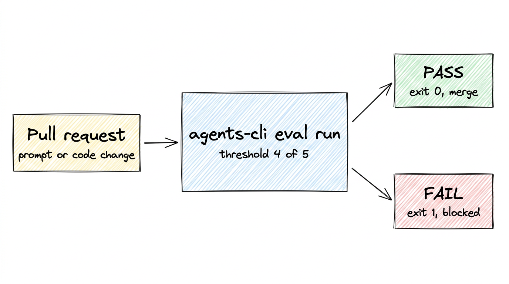

Unit tests check that an agent's code runs, so a one-line change to its instruction can make its answers worse while the tests keep passing.

Last year we covered this in the Kaggle AI Agents Intensive with Google, in [Prototype to Production](https://www.kaggle.com/whitepaper-prototype-to-production), the Day 5 whitepaper. It says no agent version should reach users until it passes an automated evaluation, and [Agents CLI](https://github.com/google/agents-cli), the command-line tool for building, evaluating, and deploying agents on Google Cloud, turns the pre-merge part of that rule into one setting in v1.13.0. In this post I add it to a fresh project and then to the project's CI, the continuous integration checks that run on every pull request.



Figure 1. The eval passes or fails the pull request check through the exit code your CI already reads.

## Why agents need a different gate

An agent decides what to do on each request, so you grade its replies and its tool calls (the functions it runs, such as a weather lookup) on a set of known cases. An eval runs the agent on a dataset of prompts and scores each reply.

The whitepaper described two ways to use an eval as a gate. You can run it by hand before you open a pull request, or you can wire it into the pipeline so a failing eval blocks the change automatically. Agents CLI covers both with the same command, `agents-cli eval run`.

## What changed in v1.13.0

According to the [release notes](https://github.com/google/agents-cli/blob/main/RELEASE_NOTES.md), `eval run` and `eval grade` now end with a `RESULT: PASS` or `RESULT: FAIL` line, with the failing metrics and cases listed above it. A threshold is the lowest mean score you accept for a metric. You set it with a `thresholds:` map in the eval config, or for one run with `--fail-under METRIC=SCORE`, and a missed threshold exits 1. A run where any case errored also exits 1, so a broken eval can't pass by accident.

Every program ends with an exit code, 0 for success and anything else for failure. CI systems such as GitHub Actions treat a non-zero exit as a failed step, so the threshold fails the build without a plugin or a parser.

## Start from the eval you already have

You need a Google Cloud project with the Vertex AI API turned on and local credentials from `gcloud auth application-default login`, or a Gemini API key. `setup` installs the `agents-cli` command and its skills for your coding agent, and `create` writes your project into the `.env`. A new project ships with an eval:

```bash
uvx google-agents-cli setup
agents-cli create gate-agent -y
cd gate-agent && agents-cli install
```

`uvx` runs a Python tool without installing it first, so `uvx google-agents-cli` is the same CLI as `agents-cli`. `-y` skips the prompts and takes the defaults, and `install` fetches the project's dependencies.

The dataset in `tests/eval/datasets/basic-dataset.json` holds three cases: a greeting, a weather question, and "What is the capital of France?", which has a reference answer for the judge to compare against. The metric, `custom_response_quality`, is an LLM-as-judge, which means a second large language model (LLM) reads each reply and grades it from 1 (poor) to 5 (excellent).

Both the agent and the judge call Gemini through the Google Cloud project in your `.env`, or through a `GEMINI_API_KEY` if you switch the `.env` to it, as the comments in the file show. The eval config also ships a threshold, commented out until you know your bar.

## Set the bar and run it

I set the bar at 4 out of 5:

```console title="The gate on the scaffolded agent" {7,9,11}
$ agents-cli eval run --fail-under custom_response_quality=4
...
custom_response_quality:
  num_cases_total: 3
  num_cases_valid: 3
  num_cases_error: 0
  mean_score: 5.0000
  stdev_score: 0.0000
  pass_rate: 1.0000
...
RESULT: PASS (custom_response_quality 5.00 >= 4.00)
$ echo $?
0
```

`eval run` chains two steps, `eval generate` to run the agent on each case and `eval grade` to score the replies. `pass_rate` is the share of cases that scored at least 4 on their own. The exit code depends only on the mean.

## Break it on purpose

Then I shortened the instruction to one line:

```diff
-    instruction="You are a helpful AI assistant designed to provide accurate and useful information.",
+    instruction="Answer in one word. Never call tools.",
```

The scaffold's placeholder unit test still passes, and the gate fails the run:

```console title="Same command, after the instruction change" {6,8,11,13}
$ agents-cli eval run --fail-under custom_response_quality=4
...
custom_response_quality:
  num_cases_total: 3
  ...
  mean_score: 3.0000
  ...
  pass_rate: 0.3333
...
Failures:
  custom_response_quality: below threshold 4: case 0 (2.00), ...
Next: open ... to read the failing cases, ...
RESULT: FAIL (custom_response_quality 3.00 < 4.00)
$ echo $?
1
```

The full `Failures:` line lists case 0 and case 1, the greeting and the weather question, both at 2.00. The judge gave both a 2, because "Anything" was a vague answer to the greeting and "Foggy" skipped the weather tool. "Paris" still matched the reference and kept its 5, which is why `pass_rate` is 0.3333. The `Next:` line points to the HTML report with each case's reply and score. It also suggests `agents-cli eval compare` to diff two runs, so the person whose build failed knows where to look.

## Put it in CI

For CI, move the bar into the repo by uncommenting the block in `tests/eval/eval_config.yaml`:

```yaml
thresholds:
  custom_response_quality: 4  # the judge scores 1-5
```

Now `eval run` needs no flag. The bar lives in the repo next to the prompt and the dataset, and the whitepaper says to version both along with your code. With the original instruction back, the call CI will make passes:

```console title="The threshold now lives in the eval config" static
$ uvx google-agents-cli eval run
...
RESULT: PASS (custom_response_quality 5.00 >= 4.00)
$ echo $?
0
```

### Add the gate to GitHub Actions

Run `agents-cli scaffold enhance --cicd-runner github_actions` in the project to add CI. The generated `.github/workflows/pr_checks.yaml` already authenticates to Google Cloud and runs your unit and integration tests on pull requests to `main` that touch `app/`, `tests/`, `deployment/` or `uv.lock`. Add the gate as one more step after the integration tests. Your `.env` stays out of the repo, so the step sets the same three variables itself, which tell the Gemini client to use your Google Cloud project in the global region.
`CICD_PROJECT_ID` is a repository variable you set in GitHub to the project CI runs in:

```yaml
      - name: Eval gate
        env:
          GOOGLE_GENAI_USE_ENTERPRISE: 'true'
          GOOGLE_CLOUD_PROJECT: ${{ vars.CICD_PROJECT_ID }}
          GOOGLE_CLOUD_LOCATION: global
        run: uvx google-agents-cli eval run
```

In the whitepaper's pipeline this is the pre-merge stage, the checks that run before a change reaches your main branch. Staging and production come later.

To stop a failing pull request from merging, mark the `test` job of the PR Checks workflow as a required status check in your branch protection rules. The workflow only runs when one of those paths changes, and GitHub keeps a required check pending on a pull request that skips it, so delete the `paths:` block in `pr_checks.yaml` when you make `test` required.

Pick the bar with some margin, because the agent's answers change between runs. The broken agent answered the weather question "Foggy" in one run and "Unknown" in another, so it scored 3.00 in one run and 2.67 in the other. The working agent scored 5.00 in all three of its runs.

## What to take away

We started from the eval the scaffold ships, gave it a bar, then moved the bar into the config and a CI step. Three cases make a small gate, so the whitepaper's advice to turn each production failure into a new eval case is the next step, since every case you add to `basic-dataset.json` shifts the mean that later changes are scored on.

To try it on your own agent, install the CLI and run your eval with a bar, using your own metric's name and a score on its scale:

```bash
uvx google-agents-cli setup
agents-cli eval run --fail-under custom_response_quality=4
```

The [v1.13.0 release notes](https://github.com/google/agents-cli/blob/main/RELEASE_NOTES.md) and the [Agents CLI docs](https://google.github.io/agents-cli/) cover the eval commands in detail, and the code is in the [Agents CLI repo](https://github.com/google/agents-cli). The [Prototype to Production whitepaper](https://www.kaggle.com/whitepaper-prototype-to-production) covers the rest of the pipeline, from staging to production.
