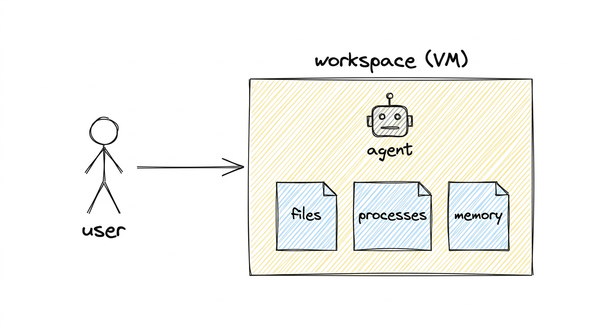
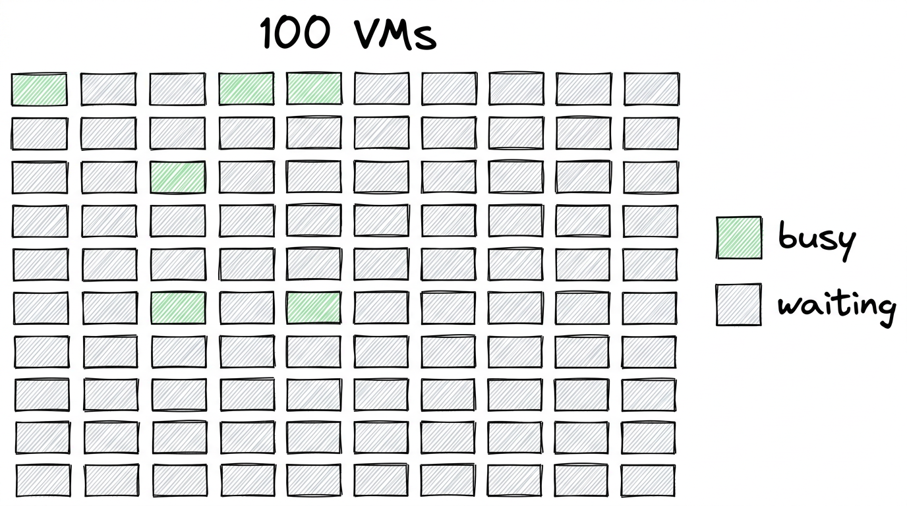
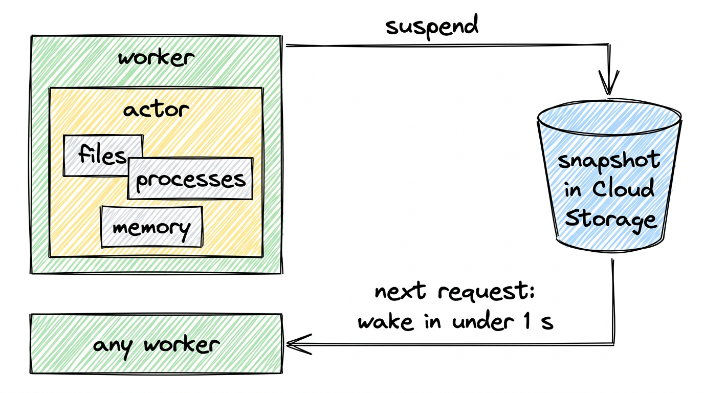
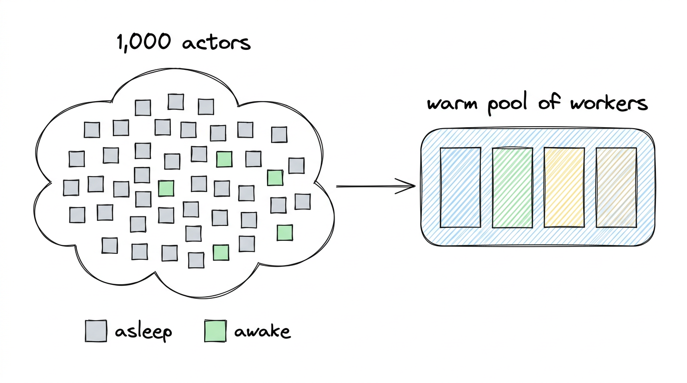

Imagine you just deployed an agent: everything works, it can edit files, run commands, start background processes and keep the whole session in memory, so a person can leave for a while and come back to an agent that knows where it was. To make that possible you gave every user their own VM. That's fine for ten users, but at a hundred most of those VMs sit idle and you still pay for them. But would it scale to a thousand users, or to millions?

Today we're going to see how to run thousands, and eventually millions, of agents efficiently with [Agent Substrate](https://github.com/agent-substrate/substrate), which hit 1.0 on November 5! It keeps each agent's memory and files and frees its place in a shared pool of workers while the agent waits, which Substrate calls a suspend. Then it wakes the agent in [under a second](https://docs.cloud.google.com/kubernetes-engine/docs/concepts/machine-learning/agent-workloads), with [sub-500 ms resumes](https://cloud.google.com/blog/products/containers-kubernetes/open-infrastructure-for-autonomous-agents-comes-to-cncf) highlighted in the 1.0 release.

## One agent, one VM

Let's start with one user and one agent. Between two messages the agent has to keep its workspace: its files, its running processes, and its memory. A VM that stays on keeps all three in one place.



Figure 1. One agent in its own VM, with its files, processes, and memory.

No other user can reach that VM, and nothing is lost between messages. The machine stays on while its user is away, a small price for one user, so let's add more.

## 100 users, 100 VMs

Now 100 users sign up and we create 100 VMs, but only a few are busy at any moment. An agent [runs code for a few seconds](https://cloud.google.com/blog/products/containers-kubernetes/open-infrastructure-for-autonomous-agents-comes-to-cncf) and then waits on a model call, an external API, or a person. A dedicated container, or a VM like ours, keeps its memory and CPU reserved through every wait, including while the person from our opening is away.



Figure 2. A few of the 100 VMs are busy and the rest wait.

You pay the same for a waiting VM as for a busy one, so your bill grows with every signup while the work grows only with the agents running at once. If you shut a VM down when its agent goes quiet, that stops its running processes and clears its memory. The user's next message then waits for a machine to boot.

## Why one Pod per agent doesn't scale to millions

At 1,000 users there are 10 times as many waiting VMs, so let's try Kubernetes, the system that runs containers across a cluster of machines. We can give each agent its own Pod (the unit Kubernetes runs containers in) instead of a VM.

A dedicated Pod still locks up memory and CPU while the agent waits. At millions of agents, the control plane (the part that manages the cluster) also has to [track millions of persistent objects](https://cloud.google.com/blog/products/containers-kubernetes/open-infrastructure-for-autonomous-agents-comes-to-cncf) it wasn't designed to hold.

Whether you use a VM or a Pod per agent, the workspace lives on the machine, so you can't keep one and release the other.

## The three parts of Agent Substrate

Agent Substrate separates the workspace from the machine. It is an open source runtime for Kubernetes with three parts:

- Actors hold each agent's memory, files, and identity, so an actor is the Figure 1 workspace with no machine attached.
- Workers are pre-started Pods that wait in a warm pool, and one worker hosts many awake actors at once, each in its own sandbox (an isolated environment for running code).
- Gateways handle network traffic: an ingress router sends requests to actors, and an egress gateway adds credentials on outbound calls.

## How an agent harness runs on Substrate

First, you set up three things. You package your agent's tools and its harness (the program that runs its loop of model and tool calls) as a standard container image. That works with [Agent Development Kit (ADK)](https://adk.dev), LangChain, Claude Code, Codex, [Google Antigravity](https://antigravity.google), or any other agent framework or harness. Next, you define an ActorTemplate (the image, environment variables, and compute resources) and a WorkerPool (the warm pool of workers), then create one actor per user session.


Figure 3. A request reaches the actor through the router, and its outbound calls leave through the egress gateway, which adds credentials outside the sandbox.

Once that is in place, each message follows the path in Figure 3:

1. Your app sends the message to the router, naming the user's actor. The router picks a warm worker with room, restores the snapshot (the actor's saved memory and files) if the actor was suspended, and forwards the request.
2. Inside the worker, the actor runs in its own [gVisor](https://gvisor.dev) sandbox or [Cloud Hypervisor](https://www.cloudhypervisor.org) microVM (a small virtual machine). A single worker [accepts up to 1,000 actors](https://docs.cloud.google.com/kubernetes-engine/docs/how-to/design-substrate-infrastructure) by default while it has CPU and memory left. Even so, each actor sees only its own files, processes, and memory, on a private network with no path to other actors or the control plane.
3. Outbound calls are [blocked](https://github.com/agent-substrate/substrate/blob/release-1.0/docs/guides/egress-traffic.md) until you add an egress policy for the hosts the agent may reach. Approved calls to the model and tools pass through the egress gateway, which adds their credentials outside the sandbox, so your keys never sit where generated code runs.
4. When the turn ends, your app or orchestrator tells Substrate to suspend the actor.

## How Substrate suspends and wakes an agent

Think of a suspend like closing a laptop lid and later finding your editor and terminal as you left them. When your app or orchestrator suspends an actor, Substrate saves a snapshot of its memory and files to local disk and to [Cloud Storage](https://cloud.google.com/storage), and frees the actor's place on its worker.

If the next request arrives within 30 minutes of suspending, Substrate schedules the actor back onto the same node and restores it from the local cache. After that, it wakes on any worker with room from Cloud Storage in under a second, so unlike your laptop, it can wake on a different machine from the one it went to sleep on.



Figure 4. A suspended actor waits as a snapshot in Cloud Storage until the next request wakes it in under a second.

Let's replay our opening with memory snapshots on. The person leaves for a while and your app suspends the actor at the end of the turn, so its files and session memory wait in the snapshot. Because RAM and the filesystem are restored intact, its running processes come back with them. The person's next message wakes the actor, and they come back to an agent that knows where it was.

To see that in a small example, you can run the [counter demo](https://github.com/agent-substrate/substrate/blob/release-1.0/demos/counter/README.md) on a local cluster set up from the repo (after its install and `go run ./cmd/ate-setup deploy demo counter` steps). The proxy keeps running in its own terminal, while a second one sends a request, suspends the actor (calling the same control-plane `SuspendActor` API your app uses), and wakes it with another request:

```bash
# terminal 1, from the substrate repo
go install ./cmd/kubectl-ate
kubectl ate create actor my-counter-1 -a ate-demo-counter --template counter
kubectl ate proxy actor my-counter-1 -a ate-demo-counter

# terminal 2
curl -X POST http://localhost:8000
kubectl ate suspend actor my-counter-1 -a ate-demo-counter
curl -X POST http://localhost:8000
```

In the demo README, the two requests return:

```text
preserved memory count: 1 | preserved file counter: 1 | preserved rootfs counter: 1
preserved memory count: 2 | preserved file counter: 2 | preserved rootfs counter: 2
```

All three counters go from 1 to 2 across the suspend, and the one in process memory keeps its value because the demo's actor template asks for `SNAPSHOT_FIDELITY_MEMORY`.

## When to suspend an agent

On [Google Kubernetes Engine (GKE)](https://cloud.google.com/kubernetes-engine), your app or orchestrator decides when to suspend an actor by calling `SuspendActor`. Putting that call in your backend lets you suspend at the exact right moment, when a turn ends or while the agent waits on an approval. After a wake, open connections such as database or Model Context Protocol (MCP) sessions [need to reconnect](https://docs.cloud.google.com/kubernetes-engine/ai-ml/about-agent-substrate).

Every suspend adds a wake to the user's next message, so wake time matters. Restoring a memory snapshot from Cloud Storage takes under a second, compared with three to five seconds for a GKE Pod snapshot, as long as the worker matches the original hardware, sandbox runtime, and container image. Wake time grows with snapshot size, so a large workspace can go on an external [Filestore](https://cloud.google.com/filestore) agent volume.

## From a thousand agents to millions

So how big does the pool of workers have to be? It only has to fit the agents awake at your busiest moment, your peak running actors. The pool works a bit like a restaurant, which needs enough seats for the people eating at the same moment, however many regulars it has.

The [infrastructure guide](https://docs.cloud.google.com/kubernetes-engine/docs/how-to/design-substrate-infrastructure) estimates peak running actors as total actors times the average fraction active (the share of users with an agent mid-turn) times a burst factor. You divide that peak by 80% of the actors one worker can hold to get the number of workers, and every other actor waits as a snapshot. For example, if 8% of 1,000 actors are active at once with a 2x burst factor, peak concurrency is 160 running actors. If each worker's CPU and memory fit 50 of our agents, dividing 160 by 80% of 50 (40 per worker) takes 4 workers.



Figure 5. A thousand actors, most of them asleep, share a small warm pool of workers, and each worker hosts many awake actors.

We asked whether it would scale to a thousand users, or to millions, and it does once every user's workspace is an actor with no machine attached. The [Substrate README](https://github.com/agent-substrate/substrate) shows about 250 stateful actors running on eight worker pods, and at 1.0 Agent Substrate is built for production workloads across [millions of sandboxes](https://cloud.google.com/blog/products/containers-kubernetes/open-infrastructure-for-autonomous-agents-comes-to-cncf) at 10 times the density of standard container runtimes.

## What to take away

- Separate the agent's workspace from its machine, so your compute scales with active turns instead of total signups.
- Call `SuspendActor` from your app when a turn ends, reconnect database or MCP sessions after a wake, and put large workspaces on Filestore volumes to keep snapshots fast.
- Size your warm pool for peak running actors with 20% headroom, and keep workers on matching hardware, runtime, and image so any worker can restore memory.
- Keep your existing framework in a standard container image, while isolating each session in a sandbox with credentials injected outside at the egress gateway.

## Try it

Want to watch an actor suspend and wake on your own cluster? Agent Substrate 1.0 is open source under Apache 2.0 in the Cloud Native Computing Foundation Sandbox, and runs on GKE Standard 1.37+ (x86 nodes) for eligible Google Cloud customers. Check the [install guide](https://docs.cloud.google.com/kubernetes-engine/ai-ml/install-overview-substrate) for prerequisites and cluster access, then run this locally (not in Cloud Shell, and it creates billable resources) to spin up the demo:

```bash
curl -sSL https://raw.githubusercontent.com/ai-on-gke/substrate-gke/main/install.sh | bash -s -- --demo
```

Dig into the [substrate repo](https://github.com/agent-substrate/substrate), the [substrate-gke installer](https://github.com/ai-on-gke/substrate-gke), and the [About page](https://docs.cloud.google.com/kubernetes-engine/ai-ml/about-agent-substrate).
